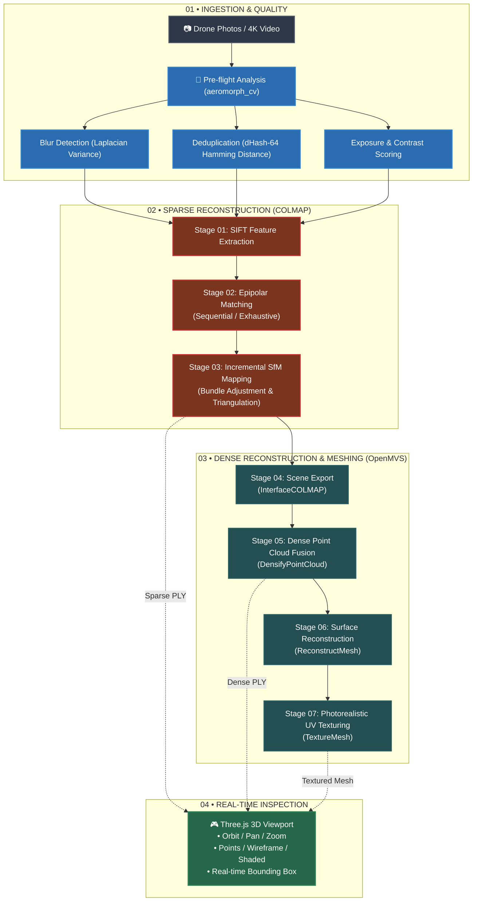
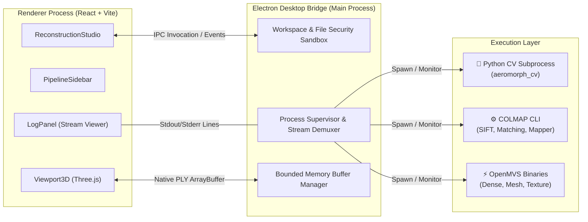

<p align="center">
  <h1 align="center">A E R O M O R P H</h1>
  <p align="center"><strong>Autonomous Desktop Photogrammetry & 3D Reconstruction Studio</strong></p>
</p>

<p align="center">
  
  
  
  
  
  
  
</p>

<p align="center">
  Transform aerial drone sweeps, high-resolution photography, and 4K video footage into millimeter-accurate 3D point clouds and textured meshes — completely offline on consumer hardware.
</p>

<p align="center">
  <a href="#key-capabilities">Key Capabilities</a> •
  <a href="#photogrammetry-pipeline">Photogrammetry Pipeline</a> •
  <a href="#system-architecture">Architecture</a> •
  <a href="#reconstruction-presets">Profiles & Presets</a> •
  <a href="#quick-start">Quick Start</a> •
  <a href="#security">Security</a>
</p>

---

<a id="executive-overview"></a>
## 🎯 Executive Overview

**Aeromorph** solves the high-barrier dilemma of aerial photogrammetry: professional 3D reconstruction typically demands enterprise cloud subscriptions, high-end server clusters, or complex command-line scripts. 

Aeromorph packages state-of-the-art **Structure-from-Motion (SfM)** and **Multi-View Stereo (MVS)** algorithms into an intuitive, resource-conscious desktop application. Engineered from the ground up for strict local execution, Aeromorph guarantees total data sovereignty while maintaining an active memory footprint optimized for everyday laptops (tested down to 8 GB RAM with integrated graphics).

```
  ┌─────────────────┐       ┌─────────────────┐       ┌─────────────────┐       ┌─────────────────┐
  │  📸 Raw Imagery  │  ──▶  │  🔬 CV Quality  │  ──▶  │  📐 Sparse SfM  │  ──▶  │  🌐 Dense MVS   │
  │  Drone / Video  │       │  Filter & Hash  │       │   Point Cloud   │       │  & Mesh Surface │
  └─────────────────┘       └─────────────────┘       └─────────────────┘       └────────┬────────┘
                                                                                         │
                                                                                         ▼
                                                                                ┌─────────────────┐
                                                                                │  🎮 Interactive │
                                                                                │  WebGL 3D Studio│
                                                                                └─────────────────┘
```

---

<a id="key-capabilities"></a>
## ✨ Key Capabilities

<table>
  <tr>
    <td width="50%">
      <h3>🔒 100% Offline & Data Sovereign</h3>
      <p>Zero telemetry, zero external APIs, zero cloud compute. Your aerial survey imagery, point databases, and resulting 3D geometry never leave your local NVMe storage.</p>
    </td>
    <td width="50%">
      <h3>🧠 Intelligent CV Pre-Flight</h3>
      <p>Built-in Python computer vision engine pre-screens image sets. Detects motion blur via Laplacian variance, eliminates redundant frames via 64-bit perceptual hashing (dHash), and flags exposure extremes before compute begins.</p>
    </td>
  </tr>
  <tr>
    <td width="50%">
      <h3>⚡ Dual-Engine Photogrammetry</h3>
      <p>Leverages industry-standard <strong>COLMAP</strong> for robust incremental bundle adjustment & feature matching, coupled with <strong>OpenMVS</strong> for high-density depth-map fusion and Delaunay/Poisson surface meshing.</p>
    </td>
    <td width="50%">
      <h3>🎮 Native WebGL 3D Studio</h3>
      <p>Integrated Three.js viewport featuring OrbitControls, camera pose indicators, live bounding boxes, wireframe/shaded modes, and crash-resilient streaming PLY parsers bounded to safe memory thresholds.</p>
    </td>
  </tr>
  <tr>
    <td width="50%">
      <h3>💻 8 GB RAM Budgeting</h3>
      <p>Out-of-core memory management, bounded buffer streaming over Electron IPC, and intelligent image downsampling presets ensure high reliability on CPU-only machines with integrated graphics.</p>
    </td>
    <td width="50%">
      <h3>🎥 Smart Video Frame Ingestion</h3>
      <p>Drop raw 4K drone video (MP4, MOV, MKV). Aeromorph automatically extracts keyframes, balances temporal spacing, and filters out camera turnarounds and low-sharpness frames.</p>
    </td>
  </tr>
</table>

---

<a id="photogrammetry-pipeline"></a>
## 🔄 Photogrammetry Pipeline

Aeromorph orchestrates an automated 7-stage reconstruction sequence. Each stage runs asynchronously with real-time log tailing, cancellation handling, and intermediate artifact persistence.



### Stage Summary

| Step | Engine | Operation | Output Artifact | Technical Purpose |
|:---:|:---|:---|:---|:---|
| **00** | `Python / OpenCV` | **Pre-Flight Ingestion** | `quality_report.json` | Prunes blurry frames ($\sigma^2 < 100$) and clusters duplicate angles ($H \le 4$). |
| **01** | `COLMAP` | **Feature Extraction** | `database.db` | Detects multi-scale SIFT keypoints invariant to rotation and illumination. |
| **02** | `COLMAP` | **Feature Matching** | `database.db` | Verifies two-view epipolar geometry using guided sequential or exhaustive matching. |
| **03** | `COLMAP` | **Incremental SfM** | `sparse/0/points3D.bin` | Recovers intrinsic/extrinsic camera parameters and initial sparse point cloud. |
| **04** | `OpenMVS` | **InterfaceCOLMAP** | `scene.mvs` | Transposes COLMAP cameras, undistorted images, and sparse ties to OpenMVS format. |
| **05** | `OpenMVS` | **Dense Point Cloud** | `scene_dense.ply` | Multi-view patch matching and depth-map fusion yielding millions of colored 3D points. |
| **06** | `OpenMVS` | **Mesh Reconstruction** | `scene_mesh.ply` | Delaunay tetrahedralization and graph-cut surface extraction. |
| **07** | `OpenMVS` | **Mesh Texturing** | `scene_textured.ply` | Global camera projection, seam leveling, and high-resolution texture map baking. |

---

<a id="system-architecture"></a>
## 🏗️ System Architecture

Aeromorph is split into decoupled, fault-isolated subsystems communicating over secure, asynchronous IPC boundaries:



### Engineering Highlights

* **Memory-Ceiling Protection:** Enforces strict memory thresholds (`AEROMORPH_MAX_PLY_MB`, default 100 MB, max 1 GB) on model ingestion to protect V8 heap and WebGL context from allocation panics.
* **Non-Blocking Process Supervision:** Spawns native binaries (`colmap.exe`, `DensifyPointCloud.exe`, `python.exe`) with line-buffered stream listeners. UI remains responsive at 60 FPS while heavy math runs on background worker threads.
* **Workspace Path Hardening:** Employs canonical path resolution, symlink rejection, and explicit dialog authorization to prevent path traversal attacks.
* **Graceful Pipeline Interruption:** Implements atomic job state tracking (`idle` $\to$ `running` $\to$ `completed` / `cancelled` / `failed`) with clean tree-kill signals to child processes.

---

<a id="reconstruction-presets"></a>
## ⚙️ Reconstruction Presets

Aeromorph provides carefully balanced presets tailored to different hardware capabilities and project requirements:

| Preset | Target Use Case | Feature Size | Matcher Mode | OpenMVS Resolution | RAM Target |
|:---|:---|:---:|:---:|:---:|:---:|
| ⚡ **Fast** | Rapid on-site aerial checks & verification | 1600 px | Sequential (Neighboring frames) | Level 2 (Downsampled $4\times$) | ~4 - 6 GB |
| ⚖️ **Balanced** *(Default)* | Architectural sweeps, facades & assets | 2000 px | Sequential + Loop closure | Level 2 (Optimal speed/detail) | ~8 GB |
| 💎 **Full Precision** | Archival scans, surveying & terrain meshes | Original | Exhaustive (All-to-all pairs) | Level 1 (Full resolution) | 16 GB+ |

---

<a id="quick-start"></a>
## 🚀 Quick Start

### Prerequisites

Ensure the following tools are installed on your host system:

* **OS:** Windows 10 / 11 (64-bit)
* **Node.js:** v18.0.0 or higher
* **Python:** v3.10 or higher (`pip install -r python/requirements.txt`)
* **COLMAP:** Installed and available in system `PATH` (or default install directory)
* **OpenMVS:** Binaries compiled and available in system `PATH` (or standard `C:\OpenMVS\bin`)

### Installation & Launch

1. **Clone the repository:**
   ```bash
   git clone https://github.com/your-username/aeromorph.git
   cd aeromorph
   ```

2. **Install root & frontend dependencies:**
   ```bash
   npm install
   cd frontend && npm install && cd ..
   ```

3. **Install Python computer vision dependencies:**
   ```bash
   pip install -r python/requirements.txt
   ```

4. **Launch the development studio:**
   ```bash
   npm run dev
   ```
   *This starts the Vite dev server and launches the Electron application with hot-reloading and live IPC logging.*

5. **Build for production:**
   ```bash
   npm run build
   ```

---

## 🎮 Interactive 3D Viewport Controls

| Input | Action |
|:---|:---|
| **Left Click + Drag** | Orbit camera around center of mass |
| **Right Click + Drag** | Pan camera laterally |
| **Scroll Wheel** | Zoom in / out with logarithmic dampening |
| **Shaded Mode** | Render solid mesh faces with studio directional lighting |
| **Wireframe Mode** | Inspect Delaunay triangulation density and polygon topology |
| **Points Mode** | Visualize raw point cloud with RGB vertex color preservation |
| **Reset View** | Auto-focus camera on model's calculated bounding sphere |

---

## 📁 Repository Structure

```text
Aeromorph/
├── electron/                   # Desktop application core
│   ├── main.cjs                # Process supervisor, IPC handlers & binary runner
│   └── preload.cjs             # Context-isolated secure desktop bridge
├── frontend/                   # React + Vite user interface
│   ├── src/
│   │   ├── components/         # Studio UI components
│   │   │   ├── ReconstructionStudio.jsx  # Main orchestrator & studio view
│   │   │   ├── Viewport3D.jsx            # Three.js WebGL 3D renderer
│   │   │   ├── PipelineSidebar.jsx       # Preset & execution configuration
│   │   │   ├── ImportPhotographs.jsx     # Image & video ingestion
│   │   │   ├── LogPanel.jsx              # Real-time stdout/stderr console
│   │   │   └── ProjectsHome.jsx          # Project manager & workspace selector
│   │   └── services/           # IPC client wrappers & state storage
│   └── index.html
├── python/                     # Offline Computer Vision microservice
│   ├── aeromorph_cv/
│   │   ├── image_quality.py    # Laplacian variance blur & exposure checks
│   │   ├── frame_filter.py     # 64-bit dHash & Hamming duplicate clustering
│   │   ├── feature_analysis.py # Keypoint density & ORB distribution
│   │   ├── video_extractor.py  # Keyframe extraction from video streams
│   │   └── pipeline.py         # Batch analysis orchestration CLI
│   └── requirements.txt
├── scripts/                    # Development runners & automation
└── test/                       # End-to-end pipeline & safety integration tests
```

---

<a id="security"></a>
## 🛡️ Security & Local-First Verification

Aeromorph is designed with a defense-in-depth posture:

> [!IMPORTANT]
> **Zero Outbound Network Traffic:** Aeromorph never sends analytics, telemetry, or user imagery across the network. All processing happens 100% on your local machine.

* **Context Isolation:** The renderer process has zero direct access to Node.js `fs` or `child_process`. All operations transit through typed, validated IPC invocations.
* **Allowlist Enforcement:** Executables are restricted to known binaries (`colmap.exe`, `InterfaceCOLMAP.exe`, `DensifyPointCloud.exe`, `ReconstructMesh.exe`, `TextureMesh.exe`, `python.exe`). Arbitrary shell execution is impossible.
* **Workspace Enclosure:** Pipeline executions write strictly inside the designated project workspace. System directories are protected against accidental overwrite.

---

## 🤝 Contributing

Contributions are welcome! Please ensure that:
1. All changes maintain compatibility with Windows 11 and 8 GB RAM targets.
2. New pipeline features include integration tests in `test/`.
3. Python additions maintain CPU-friendly dependencies without CUDA requirements.

---

## 📄 License

Aeromorph is licensed under the [MIT License](LICENSE). Built on the shoulders of giants: [COLMAP](https://colmap.github.io/) and [OpenMVS](https://github.com/cdcseacave/openMVS).
